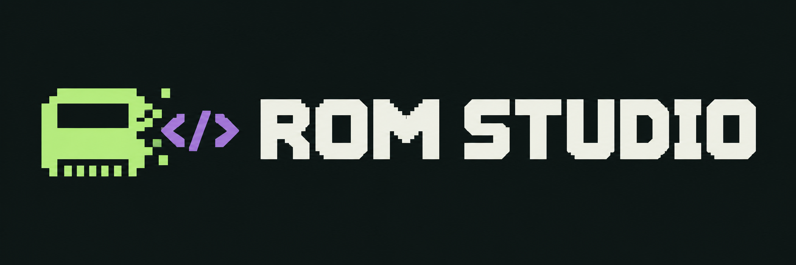

<p align="center"></p>

# ROM Studio

Understand old games. Build for the web.

ROM Studio's mission is to make original games playable on the web and make their engineering understandable. Its path is **ROM → TypeScript → Web**: recover the original instructions, explain their behavior, and build a static browser game. TypeScript compiles to JavaScript for delivery; games run without Emscripten.

## Project goals

- **Recover understandable game code.** Connect original bytes and assembly to generated TypeScript, meaningful routine names, data structures and explanations people can learn from.
- **Connect Play, Learn and Desk.** Let people play, step through execution, inspect registers/memory and trace behavior to original code, graphics and sound.
- **Support multiple systems.** Share translation and tooling across computers, consoles and, eventually, arcade boards, while keeping each machine's hardware separate from game logic and web presentation.
- **Play at full speed, explain exactly.** Play may use a faster [play tier](docs/ARCHITECTURE.md#execution-tiers) for system work beneath the game. Learn and ROM Desk use the exact reference tier and may run slower. Recorded routes check the two tiers against each other.
- **Make results reproducible.** Pin media hashes, preserve source mappings and validate behavior with recorded inputs, state, picture and sound comparisons. Label partial coverage and unverified accuracy explicitly.

[INSPIRATION.md](docs/INSPIRATION.md) credits Contra, RetroRecomp, arcade-decomp, TMNT, MAMEKIT and related work, explains what we want to learn from them, and sets our educational standard. **MAMEKIT explains the machine; ROM Studio explains the game.** These goals describe the intended product; the current game studies remain incomplete.

**v0.1 includes all six games across C64, NES and N64, plus the ROM Desk workbench.** [RELEASES.md](docs/RELEASES.md) records that committed scope and retained decisions. [ROM Desk](docs/DESK.md) pauses any game, steps it, and shows the original instruction beside its generated TypeScript with registers, memory, breakpoints and a system diagram.

## Run locally

Uses the Node.js version pinned in `.nvmrc` (26.12.1).

```sh
npm ci
npm run cli -- identify roms
npm run dev
```

Open the URL printed by `dev`, choose a system, then a game. `identify` inspects files and folders without executing their code. Place your original media under `roms/`; see [media inputs](docs/ROMS.md). To choose another preview port: `npm run dev -- --port 4175`.

| Command                        | What it does                                                                                                               |
| ------------------------------ | -------------------------------------------------------------------------------------------------------------------------- |
| `npm run dev`                  | Builds every game package with the current code, serves the library on port 4170 and rebuilds when source changes          |
| `npm run build`                | Builds the same packages and assembles the static site in **`dist/site/`**                                                 |
| `npm test`                     | Unit tests, plus original/static verification for games whose media are installed (`npm test -- unit` or `-- integration`) |
| `npm run check`, `npm run fix` | Format, lint and type checks; automatic fixes                                                                              |
| `npm run cli -- <command>`     | The `roms` tool: identification, one-game builds and verification, preview and recovery stages                             |

Building packages each game from its saved recovery capture; testing reruns recovery and checks the result. Deployment builds with `--deploy`, which verifies every game against the original and requires every required game to be release-ready and verified for the current sources; CI does this after the integration tests. v0.1 requires all six games and the workbench. For romstud.io, CI uses `npm run build -- --deploy --domain romstud.io`; a project-path Pages build uses `--base /romstudio/`. See [build and deployment](docs/BUILD.md).

The installed CLI is **`roms`**. From this checkout use `npm run cli -- <command>`; [CLI.md](docs/CLI.md) explains installation, identification and advanced analysis.

## Games and verification

All six games are **accepted as working** by the owner (9 November 2026) and the library offers **Play Game** for each. Their original-instruction versus static-replay checks cover documented routes, and each game's README lists its known limits. Super Mario 64 also has CPU startup, RSP audio and textured graphics studies with Learn material. The ROM Desk workbench is still required for v0.1.

| System | Game                                             | Current slice                                                                                             |
| ------ | ------------------------------------------------ | --------------------------------------------------------------------------------------------------------- |
| C64    | [Lemmings](src/games/c64/lemmings/README.md)     | First level, cursor controls, digger, checked 6/10 rescue                                                 |
| C64    | [Nebulus](src/games/c64/nebulus/README.md)       | Original title/music, Space start, first-tower movement, tunnel/lift regressions                          |
| C64    | [Elite](src/games/c64/elite/README.md)           | New commander, docked status, launch, bounded flight and views                                            |
| NES    | [Super Mario Bros.](src/games/nes/smb/README.md) | Original startup, first-world movement, run/jump and pause                                                |
| NES    | [Tetris](src/games/nes/tetris/README.md)         | Original menus, piece movement/rotation/drop and pause                                                    |
| N64    | [Super Mario 64](src/games/n64/sm64/README.md)   | Verified CPU/audio startup and first textured task; native opening scene reached, browser play unfinished |

Choose **Play Game** to play, or **Learn** for explanations and source. Games that are not yet accepted appear as **Try study**. The assembly → TypeScript explorer links observed instruction bytes to generated source-address functions. These observations are separate from checked, named interpretations such as the digger and Tetris input filter.

C64 audio follows original SID register writes with approximate synthesis. NES audio now follows original 2A07 register writes, with channel/bus fixtures, per-frame original/static PCM checks and live browser playback verified for SMB and Tetris. Analogue output remains approximate. N64 has bounded CPU/RSP/audio/graphics studies and a captured title-to-opening static replay; its worker player remains unfinished, with visible rendering artifacts and unverified browser performance. Full-speed SM64 is planned through a separate play tier, verified against the exact reference tier. These milestones do not establish complete gameplay. [Current status](docs/PROJECT-STATUS.md) separates recorded evidence, work in progress and the six-game release gate.

## Find your way around

| Location                             | Purpose                                                                           |
| ------------------------------------ | --------------------------------------------------------------------------------- |
| [`src/games/`](src/games/)           | Each game's recipe, recovery, explanatory code, browser adapter and documentation |
| [`src/transpiler/`](src/transpiler/) | Build-time decoding, recovery and assembly translation                            |
| [`src/runtime/`](src/runtime/)       | CPU semantics and shared execution clock                                          |
| [`src/systems/`](src/systems/)       | C64, NES and N64 hardware, memory maps and input wiring                           |
| [`src/web/`](src/web/)               | Library navigation, browser controls, presentation and audio output               |
| [`docs/`](docs/README.md)            | Shared architecture, CLI, build, hardware references and status                   |
| `dist/tools/`                        | Compiled development tools                                                        |
| `dist/work/`                         | Recovery evidence, generated game packages and local checks                       |
| `dist/site/`                         | Complete static website for deployment                                            |

Tests live beside the source they test. `npm test -- unit` runs synthetic checks; `npm test` also runs integration tests, including game verification, that use locally supplied media. See [CONTRIBUTING.md](CONTRIBUTING.md) to add a game or system.

Project domain: **romstud.io**. Future explorations: [Blue sky](docs/BLUESKY.md).

Repository: [benbruscella/romstudio](https://github.com/benbruscella/romstudio). v0.1 remains under development; pushing or deploying requires the owner's explicit approval.
