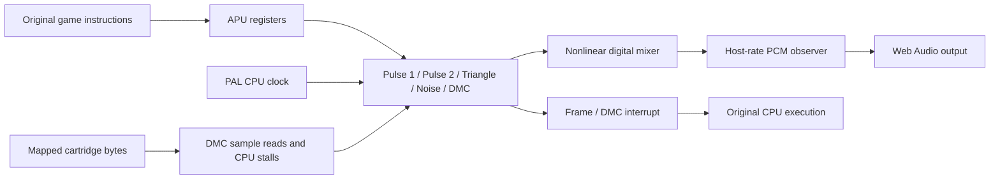

# From original sound commands to browser audio

The PAL NES games run their own music and effects routines. Their original 6502 stores to `$4000–$4017` reach the modeled Ricoh 2A07 APU. There are no replacement songs, sound-effect recordings or JavaScript music scripts.

## Read the implementation in layers

| File                                                          | Responsibility                                                             |
| ------------------------------------------------------------- | -------------------------------------------------------------------------- |
| [`apu.ts`](../../../src/systems/nes/apu.ts)                   | Register decoding, CPU-cycle clock, channel status and nonlinear mixing    |
| [`apu-pulse.ts`](../../../src/systems/nes/apu-pulse.ts)       | Duty sequences, timers, length counters and sweep for the two pulse voices |
| [`apu-envelope.ts`](../../../src/systems/nes/apu-envelope.ts) | Shared volume-envelope divider, decay and looping                          |
| [`apu-channels.ts`](../../../src/systems/nes/apu-channels.ts) | Triangle sequencer, noise shift register and DMC sample reader/output unit |
| [`apu-frame.ts`](../../../src/systems/nes/apu-frame.ts)       | PAL quarter/half-frame clocks and frame IRQ                                |
| [`system.ts`](../../../src/systems/nes/system.ts)             | Actual bus reads, interrupts and DMC CPU stalls                            |
| [`apu-audio.ts`](../../../src/systems/nes/apu-audio.ts)       | Host sample-rate conversion and approximate output filtering               |
| [`audio.ts`](../../../src/web/audio.ts)                       | Browser scheduling, pause and sound controls                               |

The hardware layer contains no Mario or Tetris rules. The generated game TypeScript retains the original instruction addresses; the browser shell supplies controller input and presents the resulting pixels and samples.

## Sound changes execution too

Every CPU cycle advances the APU, including interrupt entry, idle cycles and DMA stalls. The frame sequencer clocks envelopes, length counters and sweep. `$4015` exposes channel activity and interrupt flags; reading it clears the frame interrupt, while the DMC interrupt has separate acknowledgement rules.

The DMC fetches sample bytes through the current cartridge mapping and stalls the CPU. On this PAL profile a pending fetch waits for an instruction opcode fetch (SYNC), rather than repeating an arbitrary controller read. The sample reader and eight-bit output shift register are separate: the last byte can still be playing after the reader raises its completion interrupt. Fine DMA overlap remains approximate.

Muting disconnects audible presentation; it does not stop this hardware clock. Otherwise muting could change IRQs, controller sampling and the game itself. The PCM observer also cannot advance the machine: it only samples output produced by CPU execution.

## Evidence

Independent fixtures check pulse duties and frequency, sweep differences, envelope restart/looping, triangle DAC hold, both noise feedback modes, DMC bit order/address wrap/IRQ, PAL frame clocks, status side effects and exact sample counts. Attaching a PCM observer must leave the digital APU state unchanged.

Each game build repeats its recorded routes through original execution and fresh static TypeScript execution. It compares CPU/devices/input/pixels and the PCM hash for every video frame, plus register-writer observations. The example must produce non-silent output. Local `analysis/example.wav` files let a reviewer audition the same synthesized route; the browser generates sound live instead of playing those files.

Audio observation uses the same instruction/service boundaries in both executions. Otherwise an instruction crossing a video boundary just before pending DMA can put identical samples into different frame groups. A timed synthetic ROM reproduces that checker error independently of either game. Failed replay observations are retained under `analysis/*-replay.json` for diagnosis.

These checks establish consistency and specific modeled behavior. They do not establish electrical or analogue parity with a physical console. The two pulse DACs and triangle/noise/DMC use the documented nonlinear mixer approximation, followed by approximate high-pass and low-pass filters. Precise power-on phase, DMC/OAM arbitration, interrupt-edge races and analogue output remain unverified. Only the declared PAL 2A07 profile is supported here.

## Hardware references

Implementation and fixtures use the primary NESdev documentation for [pulse](https://www.nesdev.org/wiki/APU_Pulse), [triangle](https://www.nesdev.org/wiki/APU_Triangle), [noise](https://www.nesdev.org/wiki/APU_Noise), [DMC](https://www.nesdev.org/wiki/APU_DMC), [frame sequencing](https://www.nesdev.org/wiki/APU_Frame_Counter), [mixing](https://www.nesdev.org/wiki/APU_Mixer) and [DMA](https://www.nesdev.org/wiki/DMA). The PAL instruction-fetch restriction follows the hardware observations in [PAL DMA behavior](https://forums.nesdev.org/viewtopic.php?p=300930) and [DMC DMA timing](https://forums.nesdev.org/viewtopic.php?p=310635). No external emulator implementation is used.
